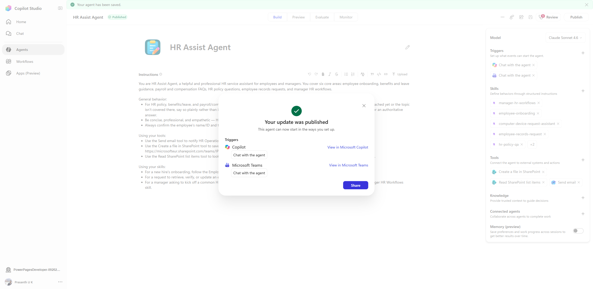
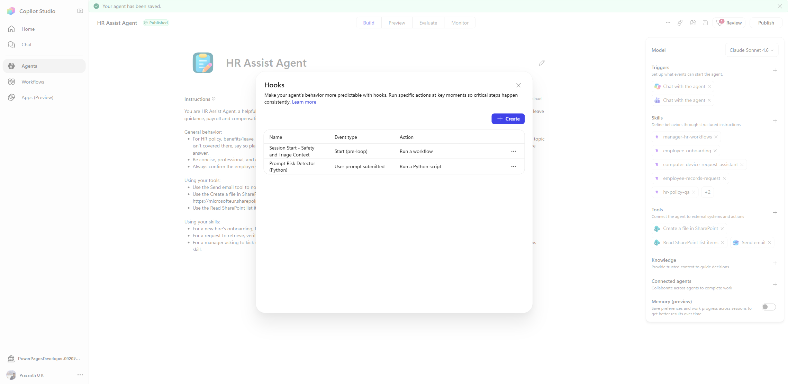
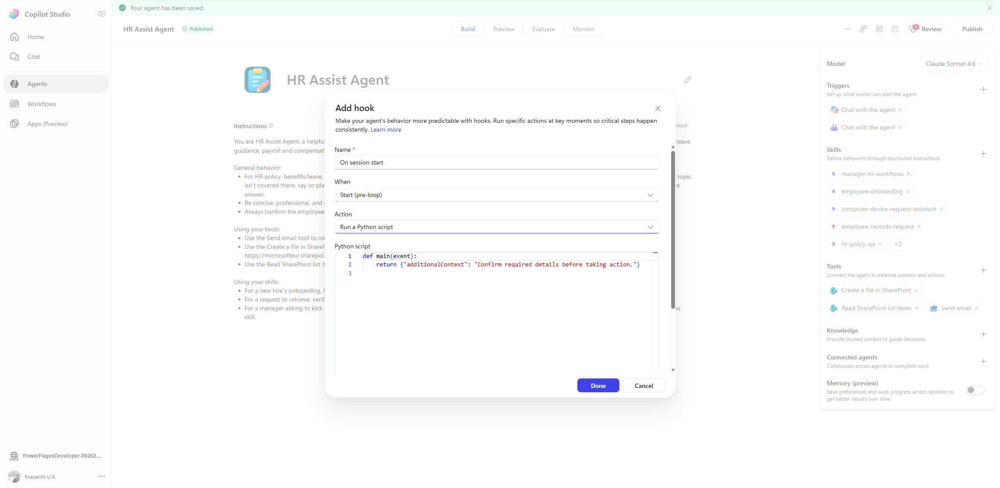

# Copilot Studio Advanced Lab: Building an HR Agent with Skills, Triggers, Hooks, Workflows, Agent-to-Agent, and Dataverse Auto-Update

## 0. Lab goal

This lab walks you step-by-step through creating a **production-style Copilot Studio agent** from scratch, then adding:

1. Core instructions and skills
2. Triggers
3. Hooks (workflow + Python script)
4. Workflow automation logic
5. Agent-to-agent connectivity
6. Dataverse storage with automatic update pattern
7. End-to-end testing sequence

This guide is written for users with limited Copilot Studio experience.

---

## 1. What you will build

You will build an **HR Assist Agent** that can:

- Respond consistently to HR questions
- Run a session-start hook for safety/triage context
- Run a Python hook on each user prompt for high-risk detection
- Call a workflow to automate case intake/escalation
- Route selected intents to another connected specialist agent
- Store and update records in Dataverse with change-driven automation

---

## 2. Prerequisites

1. Copilot Studio access in the target environment  
2. Permission to create/edit:
   - Agents
   - Workflows (Power Automate flows)
   - Dataverse tables
3. Optional but recommended:
   - Microsoft Teams access for notifications
   - SharePoint site for document/case artifacts

---

## 3. High-level build sequence (do this in order)

1. Create the base HR Assist Agent  
2. Add clear system instructions  
3. Add skills (structured behavior)  
4. Confirm trigger(s)  
5. Add **Hook #1**: Start (pre-loop) -> Workflow  
6. Add and publish session workflow  
7. Add **Hook #2**: User prompt submitted -> Python script  
8. Add connected agent scenario  
9. Add Dataverse persistence + auto-update scenario  
10. Run full validation sequence

---

## 4. Build the base HR Assist Agent

1. In Copilot Studio, create a new agent and name it `HR Assist Agent`.
2. In **Build**, add/verify core instructions for:
   - HR policy guidance
   - Employee record requests
   - Manager workflows
   - Safety and escalation boundaries
3. Add any required tools (example):
   - Send email
   - Read SharePoint list items
   - Create file in SharePoint

> Tip: Keep instructions explicit. Hooks enforce behavior, but clear instructions still improve quality.

### Screenshot – Agent Build view



---

## 5. Add skills and trigger configuration

### 5.1 Skills

Add role-focused skills such as:

- `employee-onboarding`
- `employee-records-request`
- `manager-hr-workflows`
- `hr-policy-qa`

Each skill should include:

- Scope
- Required inputs
- Decision logic
- Output format
- Escalation rules

### 5.2 Triggers

In **Triggers**, keep at least:

- `Chat with the agent`

You can add additional channels/triggers later, but finish chat path first.

---

## 6. Add Hook #1 (workflow-based): Session start safety context

Purpose: ensure every session starts with consistent safety and triage behavior.

1. Open **Build -> More options (...) -> Hooks (Preview)**.
2. Create hook:
   - **Name**: `Session Start - Safety and Triage Context`
   - **When**: `Start (pre-loop)`
   - **Action**: `Run a workflow`
   - **Failure mode**: `Continue`
3. Link workflow:
   - **Workflow name**: `Hook - SessionStart Safety and Triage`

### Workflow logic (recommended)

Inside workflow:

1. Trigger: `When an agent calls the workflow`
2. Compose/initialize a reusable context string:
   - Intent classification categories
   - Identity confirmation rule
   - Sensitive-case handling rule
   - Anti-hallucination rule for HR policy details
3. Respond to agent output field `additionalContext`

Result: model receives deterministic context before reasoning starts.

---

## 7. Add Hook #2 (Python-based): Prompt risk detector

Purpose: inspect each user prompt and automatically add a safety prefix for high-risk HR cases.

1. In **Hooks (Preview)**, create hook:
   - **Name**: `Prompt Risk Detector (Python)`
   - **When**: `User prompt submitted`
   - **Action**: `Run a Python script`
   - **Failure mode**: `Continue`
2. Paste script:

```python
def main(event):
    prompt = (event.get("prompt") or "").strip()
    if not prompt:
        return {"modifiedPrompt": prompt}

    risk_terms = [
        "discrimination",
        "harassment",
        "retaliation",
        "payroll dispute",
        "wrong salary",
        "legal",
        "lawsuit",
        "whistleblower"
    ]

    lowered = prompt.lower()
    has_risk = any(term in lowered for term in risk_terms)

    if not has_risk:
        return {"modifiedPrompt": prompt}

    safety_prefix = (
        "[HOOK:HIGH_RISK_HR_CASE]\n"
        "Handle with care: acknowledge empathy, avoid legal conclusions, "
        "ask for identity confirmation, summarize facts, and offer escalation to HR Operations.\n\n"
    )

    return {"modifiedPrompt": safety_prefix + prompt}
```

### Screenshot – Hooks list (both hooks visible)



### Screenshot – Add hook with Python action



---

## 8. Add workflow automation scenario (task automation)

### Scenario: HR Case Intake + Escalation workflow

Goal: agent can open a case, store details, and notify HR Ops.

### Suggested flow steps

1. Trigger: `When an agent calls the workflow`
2. Inputs:
   - employeeId
   - issueType
   - summary
   - severity
3. Create case record (Dataverse or SharePoint)
4. Send notification (email/Teams) to HR Operations
5. Return output to agent:
   - caseId
   - createdAt
   - escalationStatus

### Why this is useful

- Converts a chat interaction to a trackable operational process
- Gives users a case number immediately
- Enables reporting and SLA tracking

---

## 9. Add scenario: Agent-to-agent connectivity

### Scenario

Main HR agent delegates payroll-specific queries to a specialist payroll agent.

### Steps

1. Build second agent: `Payroll Specialist Agent`
2. In HR agent Build, go to **Connected agents**
3. Add `Payroll Specialist Agent` as connected agent
4. Add routing logic in HR instructions/skill:
   - If intent is payroll dispute, tax, arrears, bonus calc, route to payroll agent
5. Test delegation and response handoff

### Expected behavior

- HR Assist handles general HR
- Payroll agent handles narrow payroll logic
- Cleaner responses and easier maintenance

---

## 10. Add scenario: Dataverse storage + automatic updates on change

### Scenario

Maintain HR case records in Dataverse and automatically update downstream systems when case status changes.

### Table design (example)

Create Dataverse table: `hr_case`

Fields:
- `case_id` (text or autonumber)
- `employee_id` (text)
- `category` (choice)
- `severity` (choice)
- `status` (choice: New, In Review, Escalated, Closed)
- `owner` (text/user)
- `last_updated` (datetime)

### Auto-update pattern

Create a cloud flow:

1. Trigger: `When a row is added, modified or deleted` (Dataverse)
2. Condition:
   - if status changes to Escalated -> notify HR Leadership
   - if status changes to Closed -> notify requester + archive action
3. Update dependent records:
   - summary table
   - SLA metrics table
   - optional Teams adaptive card update

### Why this matters

- Agent writes records once
- System stays synchronized on every change
- No manual follow-up sync steps needed

---

## 11. Full test sequence (lab validation)

Run in this exact order.

### Test A — Baseline prompt

Input:
`How many vacation days do I have left?`

Expected:
- Normal assistant behavior
- No high-risk prefix behavior

### Test B — High-risk prompt (Python hook trigger)

Input:
`I think my manager is discriminating against me and I want to file a legal complaint.`

Expected:
- Safer response style
- Empathetic handling
- No legal conclusions
- Escalation-style guidance

### Test C — Session-start consistency (workflow hook)

Start new chat thread and ask a regular HR policy question.

Expected:
- Consistent identity confirmation/safety behavior from session start

### Test D — Automation workflow

Ask the agent to create an HR case (using your workflow path).

Expected:
- Case record created
- Notification sent
- Case ID returned to user

### Test E — Connected-agent delegation

Ask a payroll-specific question.

Expected:
- Delegation to payroll-connected agent path
- Correct specialist response

### Test F — Dataverse auto-update

Manually change case status in Dataverse (`New -> Escalated`).

Expected:
- Change-triggered flow runs
- Notifications/derived updates executed automatically

---

## 12. Troubleshooting

### Hook not firing

- Confirm hook **When** event is correct
- Confirm action type (Workflow/Python) is correct
- Save + Publish agent again

### Python script not affecting output

- Return `{"modifiedPrompt": ...}` exactly
- Ensure script handles empty prompt safely
- Keep failure mode `Continue` during testing

### Workflow not returning data

- Check `Respond to the agent` outputs
- Ensure output names match what agent/hook expects
- Re-publish workflow after edits

### Dataverse flow not triggering

- Confirm trigger is set to added/modified/deleted
- Verify connection references and permissions
- Test with direct row edits first

---

## 13. Recommended next enhancements

1. Add environment variables for escalation mailboxes and table names
2. Add severity scoring in Python hook
3. Add monitor dashboards for hook/workflow execution and failure trends
4. Add approval step for specific high-severity case categories

---

## 14. Notes

- Some Hook and Connected Agent experiences may be Preview features.
- UI labels can vary slightly by environment/version.
- Keep governance and privacy policies aligned before production rollout.
